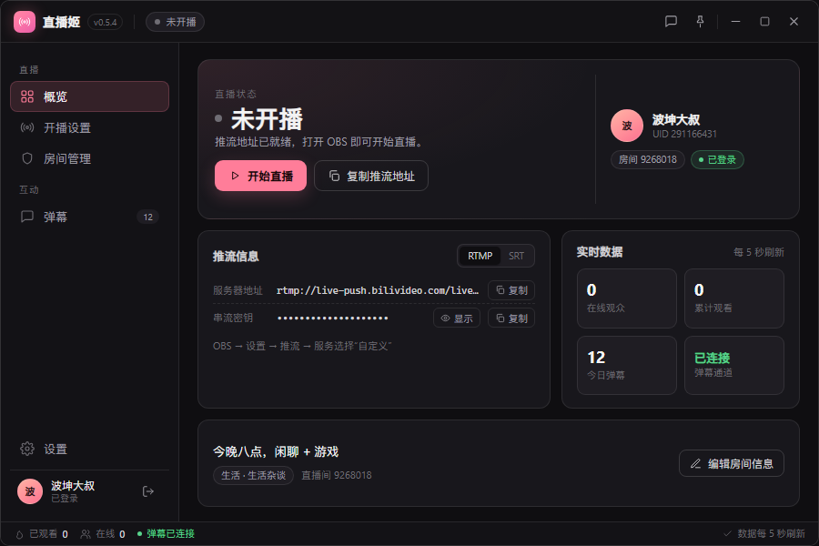
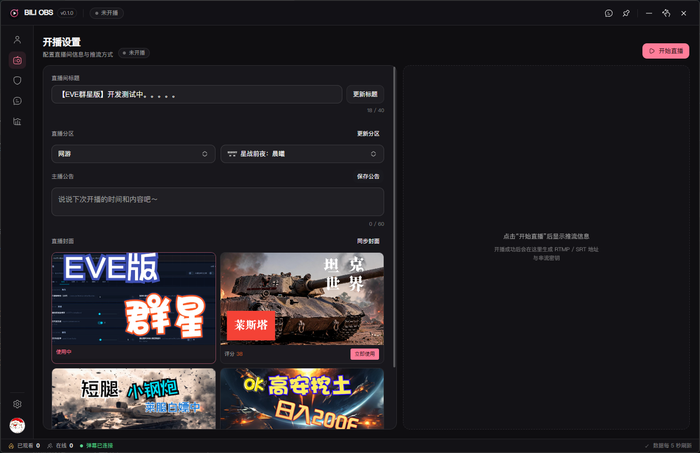
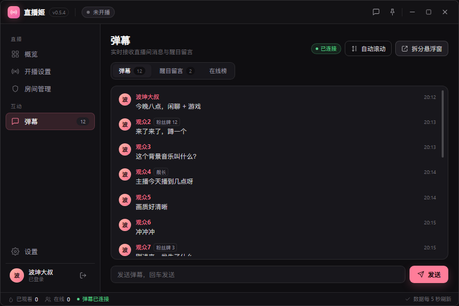
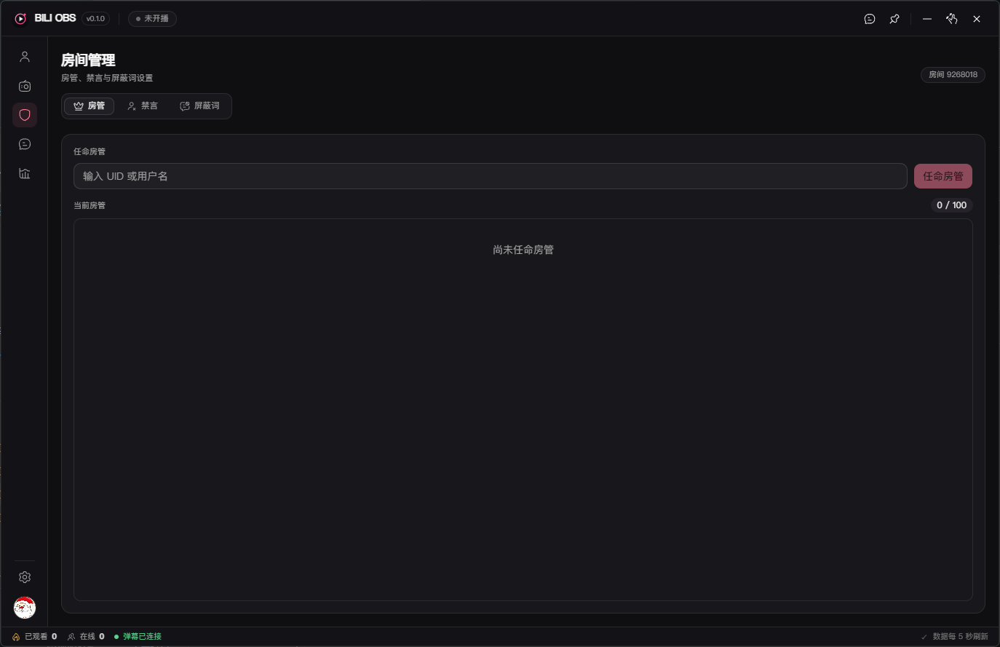
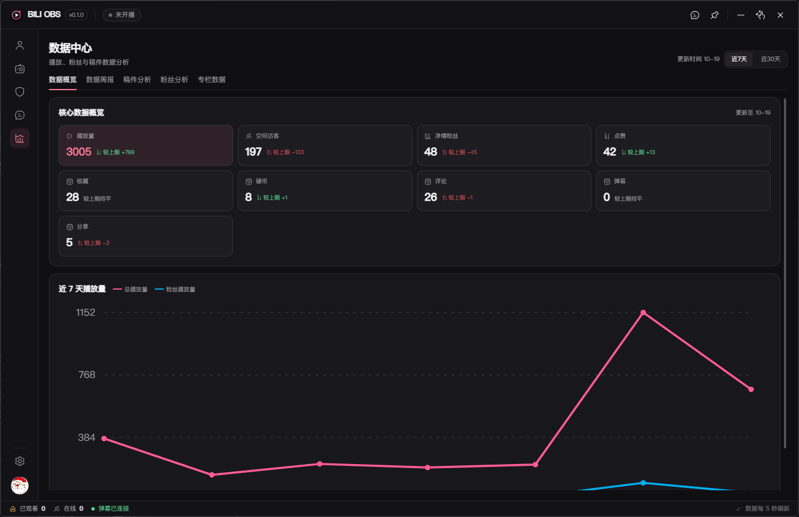
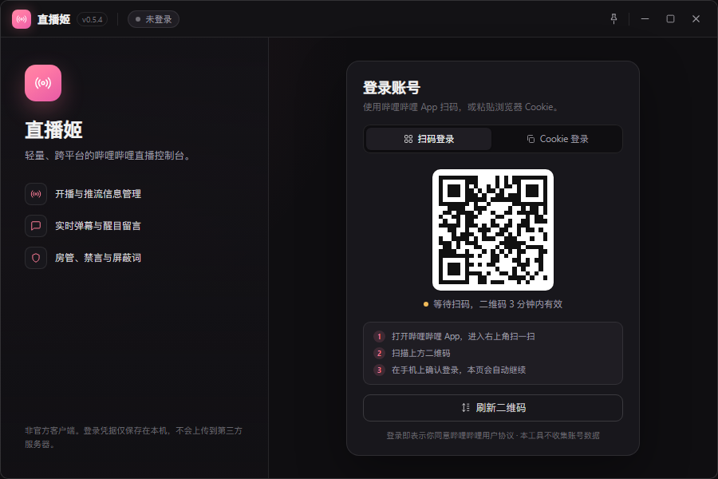

# BILI OBS

轻量的哔哩哔哩直播与创作者数据桌面工具，基于 Tauri 2 + React 19 构建。

当前版本：`0.1.4`

> 非官方客户端，与哔哩哔哩官方无任何关联。

## 界面

| 概览 | 开播设置 |
| --- | --- |
|  |  |

| 弹幕 | 房间管理 |
| --- | --- |
|  |  |

| 设置 | 登录 |
| --- | --- |
|  |  |

## 交流群

遇到问题、有建议，或想第一时间知道更新，欢迎加入 QQ 群：**26954908**

<p align="center">
  
</p>

<p align="center">手机 QQ 扫码加群，或直接在 QQ 中搜索群号 <b>26954908</b></p>

## 功能

### 账号与概览

- 二维码扫码登录、Cookie 登录
- 侧栏固定图标模式，账号信息集中显示
- 概览显示开播状态、本场直播时长、粉丝数量及本次变化
- 违规记录：读取主播中心真实记录，点击查看违规原因、处罚结果与处罚时间
- 收益数据概览：近 30 天收益、较上期变化、可提现收益、近一年收益
- “成为UP主的第 N 天”按本地日期与 B 站同步

### 开播设置

- 直播间标题、分区、主播公告保存
- 直播封面：自动同步主播中心历史封面、封面评分与使用状态，可直接切换
- 开播后才显示推流信息；未开播时隐藏服务器地址与串流密钥
- 支持开始直播与停止直播

### 弹幕

- 主窗口弹幕与悬浮弹幕窗
- 悬浮窗右上角可直接调整样式：字号、文字阴影、角色颜色
- 按主播、房管、舰长、等级用户、普通会员分别设置人名与内容颜色
- 支持醒目留言、礼物、进场消息、在线榜
- 自动滚动偏好持久化

### 房间管理

- 房管任命 / 撤销
- 用户禁言、禁言时长、解除禁言
- 全局禁言规则（荣耀等级 / 粉丝勋章 / 全员）与倒计时
- 屏蔽词增删与上限计数

### 数据中心

- 数据概览：播放量、空间访客、净增粉丝、点赞、收藏、硬币、评论、弹幕、分享
- 近 7 天总播放量与粉丝播放量双折线
- 悬浮折线显示当天数据与播放来源 Top3
- 数据周报：周播放总量、周粉丝播放、单日最高
- 粉丝分析：粉丝总量、新增 / 取消关注、活跃粉丝、来源分布、兴趣标签
- 稿件分析：视频稿件列表、播放、点赞、涨粉与分页
- 专栏数据：图文文章的阅读、评论、收藏、点赞、分享、硬币与文章列表

### 其他

- 深色 / 浅色主题
- 系统托盘：关闭主窗口后驻留托盘，可从托盘恢复或彻底退出
- 无控制台窗口（Windows GUI 子系统）

## 数据目录

所有配置与 WebView2 缓存都保存在程序同级的 `_User Data`，首次运行自动创建，不写入 C 盘用户目录：

```text
BILI OBS.exe
_User Data/
  app-config.json
  WebView2/
```

请将程序放在具有写权限的目录中运行。

## 开发

环境要求：

- Node.js ≥ 18
- Rust stable

```bash
npm install
npm run tauri dev
```

构建：

```bash
npm run build
npm run tauri build
```

生成调试测试包：

```bash
npx tauri build --debug --no-bundle
```

## 目录结构

```text
src/                 React 前端
  api/               B 站接口与签名
  components/        UI 组件
  hooks/             业务 hooks
  view/              页面
src-tauri/           Tauri / Rust 后端
imgs/                README 截图
```

## 说明

- 需要登录哔哩哔哩账号后使用大部分功能。
- 创作者数据接口需要账号具备对应权限。
- 部分图片、收益、粉丝画像和专栏统计由哔哩哔哩接口返回，接口调整时可能暂时不可用。
